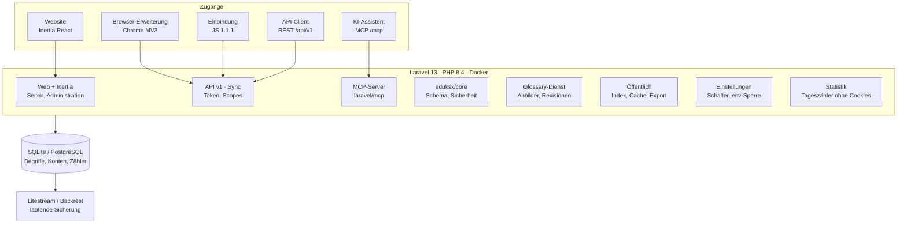
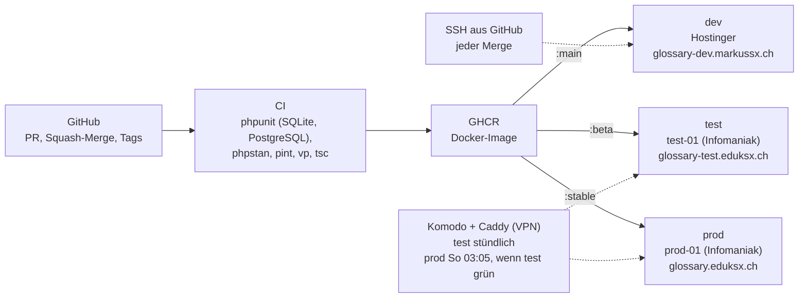

# Entwickler-Stack EduKSX-Glossary

Stand 22.11.2026 (Glossary 0.18.0-beta.1 plus Merges bis #497). Reine Übersicht, keine Konzeptänderung; massgebend
sind die Dokumente im Repo [EduKSX-Glossary](https://github.com/MarkusKeller8200/EduKSX-Glossary) (`DEPLOY.md`,
`docs/KONZEPT-DEPLOYMENT.md`) und für den Betrieb [MarKusSX-Operation](https://github.com/MarkusKeller8200/markussx-operation).
Als bearbeitbares Whiteboard: [Entwickler-Stack EduKSX-Glossary](https://claude.ai/artifact/7rRR1wivpJYFbrAzQg1Bjw)
(claude.ai, privat bis zum Teilen).

## Anwendung

Fünf Zugänge greifen auf dieselbe Laravel-App zu.

| Teil              | Inhalt                                                                                         |
| ----------------- | ---------------------------------------------------------------------------------------------- |
| Website           | Inertia mit React und TypeScript, öffentliche Seiten und Administration                        |
| Erweiterung       | Browser-Erweiterung (Manifest V3), lädt den Index einmal täglich, Melden von Kandidaten         |
| Einbindung        | Paket `glossary-highlighter` (Einbindung und Web-Komponenten 1.1.1)                            |
| MCP               | `laravel/mcp` 1.2.1, Streamable HTTP unter `/mcp`, nur lesend (Phase 1)                         |
| API               | REST `/api/v1` (öffentlich, Servicekonten mit Scopes), interner Sync unter `/api/sync`          |
| eduksx/core       | gemeinsames Paket der Produktfamilie: Schema-Härtung, Fehlerformat, Sicherheits-Header         |
| Daten             | SQLite zu Beginn, PostgreSQL in der CI und später auf prod; Sicherung mit Litestream/Backrest  |

## Auslieferung

Jeder Merge erzeugt ein Image; welche Umgebung es übernimmt, entscheidet der Image-Tag.

- **Beta** (`X.Y.Z-beta.N`) setzt `:beta` → test. **Release** (`X.Y.Z`) setzt zusätzlich `:stable` → prod im
  nächsten Wartungsfenster.
- Der **Entwicklungs-Sync** (dev ↔ test/prod) läuft über die App selbst (`/api/sync`, Administration › System ›
  Sync), nicht über die Auslieferung.
